[English](README.md) · **Українська**

[](https://warehouse-kycile24.onrender.com)

Warehouse допомагає знайти товар на складі та вирішити, що час замовити. Панель показує нестачу запасів, закупівлі в очікуванні, активні замовлення клієнтів та останні складські операції. Через API можна керувати товарами, складами, постачальниками й клієнтами.

**[Відкрити склад](https://warehouse-kycile24.onrender.com)**

## Від комірки до плану закупівлі

| Завдання | Як виконати |
| --- | --- |
| Знайти товар | Введи назву або SKU, вибери склад чи категорію. У результатах побачиш точну комірку зберігання. |
| Виявити нестачу | Відсортуй позиції за доступною кількістю й переглянь товари, залишок яких досяг порогу поповнення. |
| Підготувати закупівлю | Додай позиції до плану, вкажи потрібну кількість і завантаж CSV для роботи в електронній таблиці. |

У публічному демо є 33 товари на двох складах. Каталог працює на окремій базі SQLite в режимі читання. Чернетка закупівлі зберігається у браузері. Експорт створює файл, а оформлення замовлення залишається окремим кроком.

## Локальний запуск

Встанови Docker із підтримкою Linux-контейнерів. У змінній середовища `WMS_DB_PASSWORD` задай надійний пароль SQL Server, а в `WMS_JWT_SECRET` — випадковий секрет завдовжки щонайменше 32 байти. Виконай у корені репозиторію:

```sh
docker compose up --build
```

Відкрий [панель складу](http://localhost:8080) і вибери мову в шапці. Для нової бази створи обліковий запис через `POST /api/auth/register` у [довідці API](http://localhost:8080/swagger), потім увійди. Назви товарів і складів відображаються так, як їх записали в базі.

## Архітектура

| Компонент | Відповідальність |
| --- | --- |
| Wms.Api | HTTP-запити, автентифікація JWT, OpenAPI та вебінтерфейс |
| Wms.Application | Складські операції, передавання й перевірка даних, звіти |
| Wms.Domain | Товари, рух запасів, склади та замовлення |
| Wms.Infrastructure | SQL Server, Entity Framework Core, репозиторії та служби автентифікації |

## Розробка

Для повної версії потрібні .NET 10 SDK і SQL Server. Передай `ConnectionStrings__DefaultConnection` та `JwtSettings__Secret` через змінні середовища.

```sh
dotnet build src/Wms.Api/Wms.Api.csproj
dotnet test tests/Wms.UnitTests/Wms.UnitTests.csproj
dotnet run --project src/Wms.Api
```

Після входу панель отримує дані через захищені маршрути API. Браузер запам’ятовує мову, а токен доступу тримає в пам’яті до завершення сеансу сторінки.
